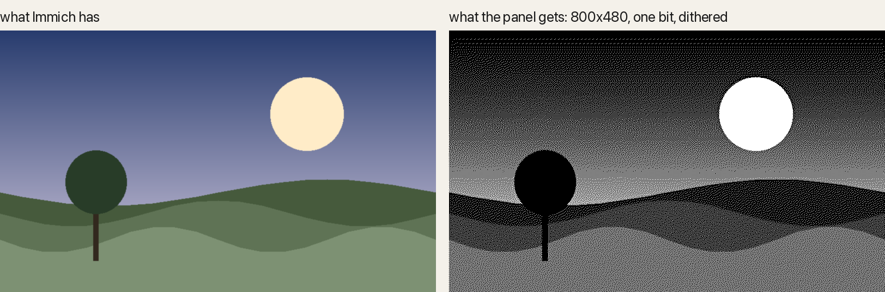
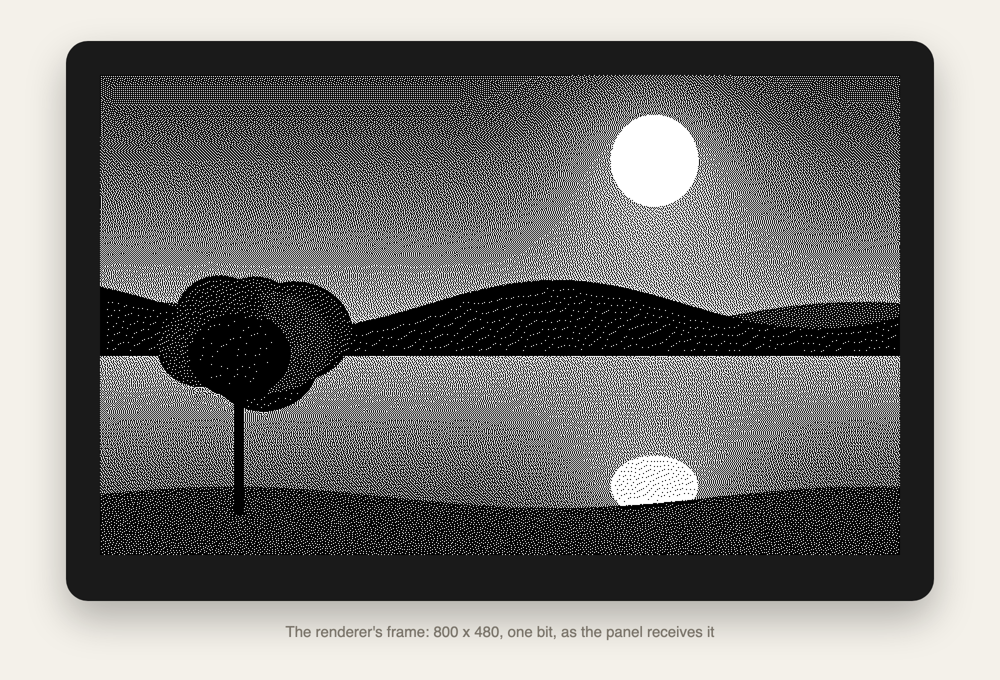
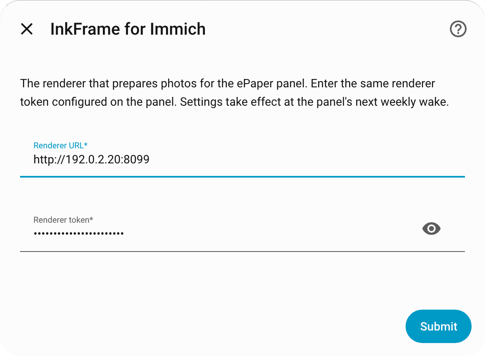
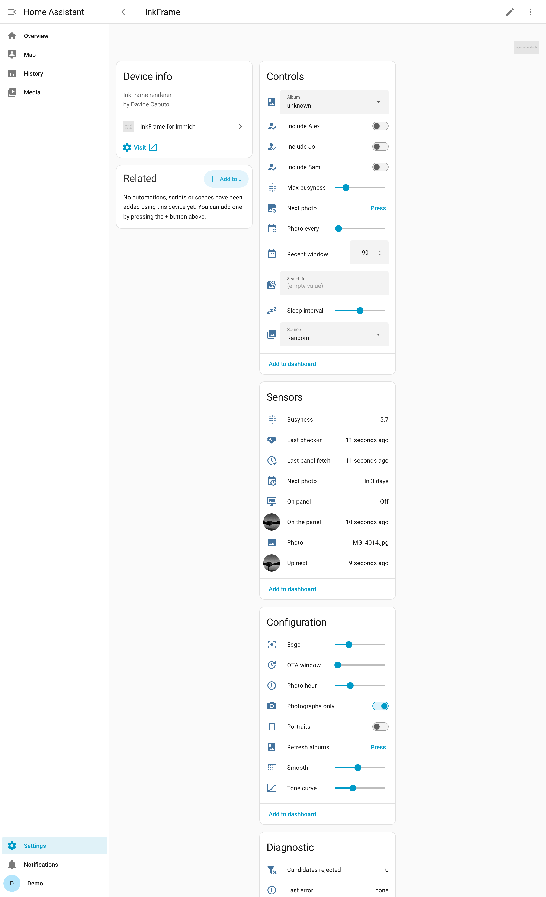
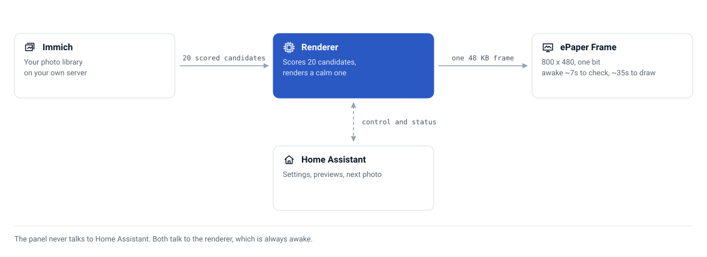
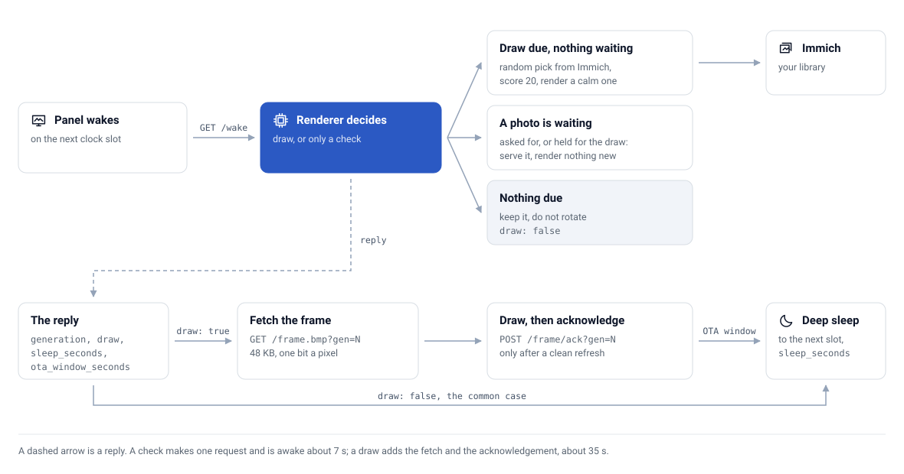

<div align="center">


# 🖼️ InkFrame for Immich

**Put one well-chosen photo from your Immich library on a battery e-paper frame each week, with the source and the look controlled from Home Assistant**


[](https://hacs.xyz)

[](https://github.com/CaputoDavide93/InkFrame-Immich/releases)
[](https://github.com/CaputoDavide93/InkFrame-Immich/actions/workflows/ci.yml)

</div>

---

## ✨ Features

InkFrame is a free, open-source (MIT) photo frame for a Seeed Studio XIAO 7.5" ePaper Panel. A small server reads your Immich library, picks a landscape photograph that will look good in one bit, renders it to 800x480 and hands the panel a finished frame. The panel wakes, draws, and sleeps for days. A Home Assistant integration chooses where photos come from and shows you what is on the glass and what is waiting.

<div align="center">

<br><sub>A synthetic scene through the real pipeline. The frames this was built on are family photographs, which stay at home.</sub>
</div>

### Why InkFrame

You have thousands of photographs in Immich and none of them on a wall. A screen frame needs a power cable and glows all night. An e-paper frame uses almost no power, but you load it by hand, and a photo that looks fine on a phone turns into speckle and banding on a one-bit panel.

InkFrame closes both gaps. The photos come from the library you already keep, and the server only offers the ones that survive one bit: landscape by orientation, taken by a camera, and calm enough to dither. The panel is awake about 35 seconds when it draws and about 7 when it only checks.

| | InkFrame | Screen frame or tablet showing an Immich slideshow | Hand-loaded e-paper frame |
|---|---|---|---|
| Power | Battery cell; awake about 35 s per draw, about 7 s per check | Mains power, display on | Battery |
| Where photos come from | Your Immich library, read by your own server | Your Immich library, through its app or a browser | Pictures you copy or upload yourself |
| Chooses photos that suit the display | Yes: orientation, camera, busyness score, face-aware crop | Not needed, the screen shows anything | Depends on the frame |
| Prepares the image | The server dithers to one bit; the panel only copies it | The screen decodes the photo | Depends on the frame |
| Control | Home Assistant: source, people, album, search, render tuning | The slideshow app | Depends on the frame |
| Colour and motion | Black and white, a new photo every few days | Colour, can move | Depends on the panel |

The trade-off: the panel sleeps for days and cannot be woken from the network, so a change you make in Home Assistant reaches the glass at its next wake, not at once. You also need a small server running all the time next to Immich.

### Install in 3 steps

1. **Run the renderer** on a machine that can reach Immich: copy `server/.env.example` to `server/.env`, set `IMMICH_URL`, run `docker compose up -d`.
2. **Flash the panel** with `esphome run firmware/immich-frame.yaml` after filling in `firmware/secrets.yaml`.
3. **Add the integration** through HACS (custom repository, category Integration), restart Home Assistant, then **Settings → Devices & Services → Add Integration → InkFrame for Immich**.

You need an Immich API key and a shared token first, the hardware, and Docker. The details and every command are in [Quick Start](#-quick-start) and [docs/setup.md](docs/setup.md).

### What you get

| | Feature | What it does |
|---|---|---|
| 🧠 | Renderer (`server/`) | Picks a landscape photograph from Immich, crops it to 800x480, tones and dithers it, and serves the frame as PNG, BMP or a raw framebuffer |
| 🌾 | Photos that suit one bit | Landscape by EXIF orientation, taken by a camera, scored for texture, and the calmest of twenty candidates wins |
| 🖼️ | Portraits cropped, not skipped | A portrait is cropped to the panel with the window placed on the faces Immich found, or skipped if you prefer |
| 📟 | Firmware (`firmware/`) | ESPHome config for the XIAO panel: wake, fetch, draw, sleep. Sleep interval and OTA window arrive from the server, so changing them needs no reflash |
| 🏠 | Home Assistant device | Choose the source, tune the render, see the frame before the panel does, and know whether the panel collected it |
| 🔎 | Six sources | Random, recent, people, one person, an album, or a text search such as "cat" |
| 🔋 | Short awake time | Most wakes only check (about 7 s); a draw takes about 35 s |
| ✅ | Honest status | `On panel` turns true only after the panel acknowledges a successful draw, because a downloaded frame is not a displayed one |
| 🔒 | Token on every call | Every endpoint except the `/healthz` liveness probe needs the shared bearer token |
| 🔁 | Settings survive redeploys | What you set in Home Assistant is stored on the renderer, and environment variables only seed a fresh install |

### Supported hardware and software

| Part | Status |
|---|---|
| Seeed Studio XIAO 7.5" ePaper Panel (ESP32-C3, UC8179, 800x480) | ✅ Tested: the author's frame |
| Other e-paper panels | ❔ Unverified. The renderer's size is a constant and the firmware needs a matching display model; see [Hardware](docs/hardware.md#other-panels) |
| Colour or greyscale panels | ❌ Not supported: the dither target is one bit |
| Renderer in Docker (Python 3.12 image) | ✅ Tested: pytest in CI and the author's live renderer |
| Immich | ✅ Tested on the author's server. The release is not recorded, so other versions are unverified. Calls used: [docs/how-it-works.md](docs/how-it-works.md#what-the-renderer-asks-immich) |
| Home Assistant | ✅ Config flow and entities exercised on 2026.9.4 for the screenshots; hassfest and HACS validation run in CI; 2025.1.0 is the declared minimum and unverified |
| ESPHome 2026.9 | ✅ Config validated in CI and flashed to the author's panel |

Running other hardware or another Immich release? [Open an issue](https://github.com/CaputoDavide93/InkFrame-Immich/issues) with the details listed under [Contributing](#-contributing). This is an independent project, not affiliated with or endorsed by Seeed Studio or Immich.

---

## 📸 Screenshots

Taken from the real renderer and a real Home Assistant, on drawn demo scenes (`make screenshots`). Every setup screen is in [docs/setup.md](docs/setup.md).

<picture>
  <source media="(prefers-color-scheme: dark)" srcset="docs/assets/screenshots/frame-dark.png">
  
</picture>

<table>
<tr>
<td width="50%">

<picture>
  <source media="(prefers-color-scheme: dark)" srcset="docs/assets/screenshots/setup-form-dark.png">
  
</picture>

**Setup** asks for two things: the renderer's address and the shared token

</td>
<td width="50%">

<picture>
  <source media="(prefers-color-scheme: dark)" srcset="docs/assets/screenshots/device-dark.png">
  
</picture>

**One device**: the source, the tuning, and what is on the glass versus what is waiting

</td>
</tr>
</table>

---

## 🗺️ Architecture

<picture>
  <source media="(prefers-color-scheme: dark)" srcset="docs/assets/architecture-dark.svg">
  
</picture>

The panel never talks to Home Assistant and Home Assistant never talks to the panel. Both talk to the renderer, which is awake all the time. A setting you change in Home Assistant is stored on the renderer and takes effect at the panel's next wake. The one entity that tells you whether a photo actually reached the glass is `On panel`; see [why that matters](docs/home-assistant.md#rendered-is-not-displayed).

The weekly wake, end to end:

<picture>
  <source media="(prefers-color-scheme: dark)" srcset="docs/assets/wake-sequence-dark.svg">
  
</picture>

[How it works](docs/how-it-works.md) is the short version of the whole system; [Architecture](docs/architecture.md) has the reasoning.

---

## 🚀 Quick Start

**You need:** an Immich server, Home Assistant, a host with Docker for the renderer (it can be the Immich host), the XIAO 7.5" ePaper Panel with a USB-C cable, and a computer with Python to flash it. The full checklist is in [docs/setup.md](docs/setup.md#before-you-start).

**1. Create an Immich API key** with `asset.read`, `asset.view`, `asset.statistics`, `album.read` and `person.read`, and one shared token. Save both to files readable by uid 1000:

```bash
mkdir -p ~/Secrets
printf '%s' 'YOUR_IMMICH_API_KEY' > ~/Secrets/immich_frame_api_key
chmod 644 ~/Secrets/immich_frame_api_key
# One shared bearer for the panel and Home Assistant. Keep it secret; it grants
# access to photo previews and renderer controls.
openssl rand -hex 32 > ~/Secrets/inkframe_token
chmod 644 ~/Secrets/inkframe_token
```

**2. Run the renderer:**

```bash
cd server
cp .env.example .env          # set IMMICH_URL, at least
docker compose up -d
curl -s -H "Authorization: Bearer $(cat ~/Secrets/inkframe_token)" http://localhost:8099/status
```

**3. Flash the panel.** Copy `firmware/secrets.yaml.example` to `firmware/secrets.yaml`, fill in Wi-Fi and keys, point `frame_server_url` at the renderer, then:

```bash
pip install esphome
esphome run firmware/immich-frame.yaml
```

**4. Add the integration.** In HACS, add `https://github.com/CaputoDavide93/InkFrame-Immich` as a custom repository (category *Integration*), install **InkFrame for Immich**, restart, then **Settings → Devices & Services → Add Integration → InkFrame for Immich** and enter the renderer URL and the same `inkframe_token` used by the panel.

[](https://my.home-assistant.io/redirect/hacs_repository/?owner=CaputoDavide93&repository=InkFrame-Immich&category=integration)

Without HACS: copy `custom_components/inkframe` into `<config>/custom_components/` and restart.

**Upgrading from an older release:** access is now authenticated. Create the token file, add `inkframe_token` to ESPHome secrets, then use **Reconfigure** on the existing InkFrame integration to enter that token before deploying the protected renderer.

Step by step, with a screenshot of each Home Assistant screen: [docs/setup.md](docs/setup.md). Questions about waking the panel, battery life or other panels: [docs/faq.md](docs/faq.md).

---

## 📚 Documentation

| Guide | What it covers |
|---|---|
| [Setup](docs/setup.md) | Before you start, the key and token, the renderer, the panel, the integration, first photo |
| [FAQ](docs/faq.md) | Can I wake the panel, how long does the battery last, other panels, privacy, colour |
| [How it works](docs/how-it-works.md) | The three parts, one wake, how a photo is chosen, why rendered is not displayed |
| [Troubleshooting](docs/troubleshooting.md) | Symptom first: asleep or dead, photo did not change, empty source, negative picture |
| [Every doc](docs/README.md) | Architecture, API, rendering, firmware, hardware, operations, releasing |

---

## ⚙️ Configuration

Every knob has a sensible default. Home Assistant can change the ones marked ✅ at runtime; the value it sets is persisted and survives a redeploy.

<!-- AUTOGEN:settings -->
| Setting | Type | Range | Purpose | HA |
|---|---|---|---|---|
| `smooth` | float | 0.0 to 1.0 | Edge-preserving texture flattening before dithering | ✅ |
| `curve` | float | 0.0 to 1.0 | How hard tones are pushed away from mid-grey | ✅ |
| `edge` | int | 0 to 200 | Unsharp mask percent applied after smoothing | ✅ |
| `contrast` | float | 0.5 to 2.0 | Global contrast. Overlaps `curve`; not exposed in Home Assistant |  |
| `candidates` | int | 1 to 60 | Photos downloaded and scored per pick. Not exposed in Home Assistant |  |
| `max_busyness` | float | 1.0 to 100.0 | Reject anything scoring above this | ✅ |
| `require_camera` | bool | on / off | Only assets with a camera make in EXIF | ✅ |
| `landscape_only` | bool | on / off | Skip portraits. Off means they are cropped to fit, with the window placed on the faces Immich found | ✅ |
| `sleep_hours` | float | 1 to 336 | Delivered to the panel on `/wake` | ✅ |
| `ota_window_seconds` | int | 5 to 300 | Delivered to the panel on `/wake`. At 60 or more every wake draws the photo already on the glass, because only a drawing wake holds the window; Home Assistant's Prepare for update sets 300 for one wake | ✅ |
| `refresh_days` | int | 1 to 30 | How often the picture on the glass actually changes. Most wakes only CHECK (~7s); a draw is ~35s | ✅ |
| `refresh_hour` | int | 0 to 23 | Local hour for the scheduled draw. The first check at or after it, never an exact alarm | ✅ |
<!-- /AUTOGEN:settings -->

Environment variables set the defaults for a fresh install. The full list, generated from the code, is in [docs/api.md](docs/api.md#environment-variables).

---

## 📖 How it chooses a photo

| | Filter | Why it exists |
|---|---|---|
| 🔄 | **Landscape by orientation, not by dimensions** | Immich reports the stored EXIF width and height. Orientation values 5 to 8 transpose the image, so a photo stored 4032x3024 with `orientation: 6` renders portrait. On the library this was built against, `width > height` alone was wrong for 86% of photos |
| 📷 | **Taken by a camera** | `exifInfo.make` is set by every phone and camera and by nothing else. It keeps screenshots, memes and downloads off the wall without guessing at filenames |
| 🖼️ | **Portraits cropped, not skipped** | The panel is landscape. A portrait is cropped to 800x480 with the window placed on the faces Immich detected, so a close-up keeps its chin and a full-body shot keeps its body. Turn **Portraits** on to skip them instead |
| 🌾 | **Calm enough to dither** | Mean absolute Laplacian over the cropped frame. Grass and foliage score high and turn into speckle under any algorithm; a subject against a plain wall scores low and survives. The renderer scores twenty candidates and shows the calmest |

Sources you can choose from Home Assistant:

<!-- AUTOGEN:modes -->
| API `mode` | Home Assistant Source | Draws from |
|---|---|---|
| `random` | Random | The whole library, filtered by the settings |
| `person` | a person's name | Photos of one named person from Immich's face recognition |
| `people` | People | Photos of any of the people whose Include switch is on (a union, not an intersection) |
| `recent` | Recent | Photos taken in the last N days |
| `album` | Album | One album, read live from Immich |
| `search` | Search | Photos matching a description, ranked by Immich's smart search; the best 120 are kept |
<!-- /AUTOGEN:modes -->

A person is offered only above a minimum number of landscape photographs, because a source that runs dry repeats itself. See [Rendering](docs/rendering.md).

---

## 📁 Repo structure

```text
InkFrame-Immich/
├── server/                     # 🧠 the renderer
│   ├── src/app.py              #    HTTP server, state, /wake protocol
│   ├── src/immich.py           #    Immich client, filters, render, pack
│   ├── tests/                  # 🧪 pytest
│   ├── Dockerfile
│   └── docker-compose.yml
├── firmware/
│   ├── immich-frame.yaml       # 📟 ESPHome config for the XIAO 7.5" panel
│   └── secrets.yaml.example
├── custom_components/
│   └── inkframe/               # 🏠 Home Assistant integration
├── .github/
│   ├── workflows/ci.yml        # ✅ tests, generated docs, hassfest, HACS, ESPHome
│   ├── ISSUE_TEMPLATE/         # 🐛 bug report, feature request
│   └── dependabot.yml
├── brand/                      # 🎨 icon and logo, drawn by tools/gen_brand.py
├── docs/                       # 📚 guides, deep-dives, runbooks (index: docs/README.md)
│   └── assets/                 # 🖼️ diagrams, screenshots, demo image, brand tile, social preview
├── tools/
│   ├── gen_docs.py             # 🤖 regenerates the inventory tables
│   ├── gen_diagram.py          #    draws the docs/assets diagrams
│   ├── gen_brand.py            #    regenerates brand/, the demo and the social preview
│   ├── brand_kit.py            #    the icon tile and the social preview layout
│   └── screenshots/            # 📸 make screenshots: stand-in Immich, real renderer, real Home Assistant
├── Makefile                    # 🔧 check, test, docs, diagram, brand, screenshots
├── llms.txt                    # 🤖 the project on one plain-text page
├── AGENTS.md  CLAUDE.md        # 🧭 instructions for contributors' tools
├── hacs.json                   # 🏠 HACS metadata
└── CHANGELOG.md  CONTRIBUTING.md  SECURITY.md  LICENSE
```

---

## 🧪 Testing

```bash
make check      # renderer tests, generated tables and diagrams current
make screenshots
```

`make check` runs the renderer's pytest suite in a virtual environment, then `tools/gen_docs.py --check` and `tools/gen_diagram.py --check`. CI also runs hassfest, HACS validation and an ESPHome config check.

The tests pin the parts that are easy to get wrong and hard to notice: the orientation rule against the shapes seen in a real library, the framebuffer's size and polarity, the busyness score's independence from input resolution, and that every module the server imports is copied into the image.

---

## 🛠️ Troubleshooting

The two that catch everyone: a panel that is asleep looks identical to a dead one, and a photo the panel never fetched looks identical to one on the wall. Both, and the rest, in [Troubleshooting](docs/troubleshooting.md).

---

## 🔒 Security

The renderer holds an Immich API key and serves your photographs. Every endpoint except the `/healthz` liveness probe requires the shared bearer token, but traffic is plain HTTP, so keep it on a trusted LAN. Read [SECURITY.md](SECURITY.md) before exposing it further.

---

## 🤝 Contributing

The most useful contribution is a report from hardware or software not marked tested above. Open an [issue](https://github.com/CaputoDavide93/InkFrame-Immich/issues) with:

- the panel or display model and its controller, if it is not the XIAO 7.5" panel;
- your Immich release, Home Assistant release and ESPHome release;
- the renderer's `GET /status` output with the token removed, and the log lines from one wake;
- whether the frame on the glass matches **On the panel** in Home Assistant.

Code changes: run `make check` first, and read [CONTRIBUTING.md](CONTRIBUTING.md). Pull requests for other e-paper panels and other photo servers are welcome.

---

## 📄 License

MIT. See [LICENSE](LICENSE). Changes are recorded in [CHANGELOG.md](CHANGELOG.md).

---

<p align="center"><sub>Made with ❤️ by <a href="https://github.com/CaputoDavide93">Davide Caputo</a></sub></p>
