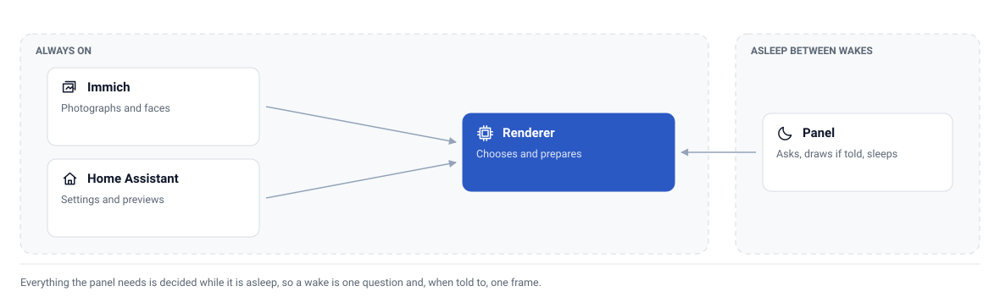
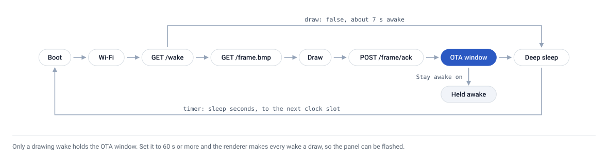

# 🗺️ Architecture

Three parts, one of which is asleep almost all the time.

<picture>
  <source media="(prefers-color-scheme: dark)" srcset="assets/topology-dark.svg">
  
</picture>

## Why the renderer exists

The XIAO ESP32-C3 has no PSRAM. After Wi-Fi and the display's own 48 KB buffer, about 200 KB of heap remains, and the largest contiguous block measured on a running panel was 20 KB. That rules out decoding a JPEG, scaling it, or dithering it on the device.

So the renderer does every expensive step and serves a frame that is already exactly 800x480 and already one bit per pixel. The panel's ESPHome `online_image` component decodes a BMP into its single image buffer and the display copies it out. That buffer is allocated once at first fetch and kept for the life of the boot; a second allocation after the heap has fragmented is the failure mode reported for this board, so the firmware never asks for one.

## Why the panel talks to the renderer and not to Home Assistant

The panel sleeps between wakes, awake about 7 seconds to check and about 35 to draw. Home Assistant cannot push to a device that has no network stack, and a device that polls Home Assistant would need Home Assistant's API to hold everything about photo selection. The renderer is the one always-on component that knows the library, so both the panel and Home Assistant talk to it.

## The wake protocol

<picture>
  <source media="(prefers-color-scheme: dark)" srcset="assets/wake-states-dark.svg">
  
</picture>

`/wake` does two things in one call.

**It decides whether to rotate.** The renderer tracks which generation the panel acknowledged after drawing. A downloaded frame is not yet a displayed frame. If Home Assistant rendered a frame yesterday and the panel has not displayed it yet, `/wake` serves that frame instead of making another. Without this rule, pressing **Next photo** the day before a wake would be undone by the wake itself.

**It carries the wake parameters.** `sleep_seconds` and `ota_window_seconds` come back in the reply. The firmware uses them for this wake's OTA window and this sleep's duration. They started life as firmware substitutions; moving them to the server means changing them from Home Assistant needs no reflash. The firmware keeps its own values only as a fallback for a wake where `/wake` is unreachable.

## Generations

Every render increments a persisted generation counter. The renderer retains the current and previous renders, the acknowledged panel image, and the panel's in-flight download. Downloads and retries name the generation returned by `/wake`; a renderer restart does not rename it. A rotation cannot substitute a different photo midway through a download. `/status` retains the field names `generation`, `panel_fetched_generation` and `on_panel`, which is true only when the rendered and acknowledged generations match.

## Rendered is not displayed

E-paper holds its last image with no power. For acknowledging firmware, downloading `/frame.*` never changes the displayed state. After its display update returns without a reported component fault, the firmware sends an authenticated `POST /frame/ack?gen=N`. Only that acknowledgement records the displayed generation and starts the next draw interval; duplicate or stale acknowledgements cannot postpone it. Home Assistant uses `/preview.png` and never sends a display acknowledgement.

The firmware's acknowledgement cannot verify physical pixels: a hardware fault that the display driver does not report can still escape detection. Firmware from before this protocol never acknowledges. Until the renderer has recorded one valid acknowledgement, a completed `/frame.bmp` or `/frame.bin` download stands in for it, so the renderer can be updated before the sleeping panel is reflashed. The first valid acknowledgement turns that fallback off for good (`/data/panel-protocol.json`).

## Memory budget on the panel

Measured on the running device, not estimated:

| | Bytes |
|---|---|
| Display buffer (800x480 / 8) | 48,000 |
| `online_image` decode buffer | 48,000 |
| Free heap after both | ~43,000 |
| Largest free block after both | 20,480 |

The receive buffer for HTTP is kept at 4 KB for the same reason. A 48 KB BMP arrives in about 4.3 seconds; the PNG it replaced was 12% smaller and took 5.2 seconds, because the panel spent the difference in the inflate pass.
