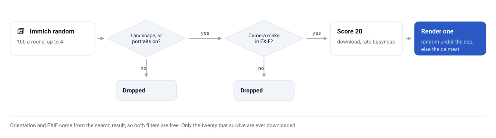

# 🔬 How it works

The whole system in one page. Each section links to the document that goes deeper.

## The three parts

| Part | Where it runs | Awake | Job |
|---|---|---|---|
| **Renderer** (`server/`) | A Docker container next to Immich | Always | Picks a photo, renders 800x480 in one bit, serves it, tracks what the panel collected |
| **Panel** (`firmware/`) | The XIAO 7.5" ePaper Panel | About 7 s to check, about 35 s to draw | Wakes on a timer, asks `/wake`, fetches the frame if told to, draws it, sleeps |
| **Integration** (`custom_components/inkframe/`) | Home Assistant | Always | One device: choose the source, tune the render, show what is on the glass and what is waiting |

The panel talks only to the renderer, and Home Assistant talks only to the renderer. They never talk to each other. [Architecture](architecture.md) explains why.

## One wake

1. The panel's timer fires and it boots, joins Wi-Fi and calls `GET /wake` with the shared token.
2. The renderer answers with `draw`, the frame's `generation`, `sleep_seconds` and `ota_window_seconds`. A wake only draws when the answer says so: a photo somebody asked for, a scheduled draw that is due, or the first frame ever. Otherwise the panel sleeps again after about 7 seconds.
3. On a draw, the panel fetches `/frame.bmp?gen=N`, a 48 KB one-bit image, and refreshes the display, which takes about 5 seconds.
4. If the display update reports no fault, the panel sends `POST /frame/ack?gen=N`. Only that call marks the photo as displayed.
5. The panel holds an OTA window (20 seconds by default) so you can flash it, then deep-sleeps for `sleep_seconds`.

The timing figures are measured on the author's panel and are explained in [Wake and sleep](wake-and-sleep.md).

## How a photo is chosen

The renderer asks Immich for candidates from the chosen source, then applies three filters and a score:

1. **Orientation.** The photo must be landscape after EXIF orientation is applied, or, with portraits switched on, it is cropped around the faces Immich found.
2. **Camera.** The EXIF `make` must be set, which keeps out screenshots, memes and downloads.
3. **Texture.** The renderer downloads up to twenty candidates and scores each by the mean absolute Laplacian of the cropped greyscale frame. Busy texture such as foliage turns into speckle in one bit, so the pick is a random candidate under the busyness cap, and the calmest only when every one is over it.

The winner is cropped to 800x480, given a tone curve, smoothed where the texture is flat, sharpened at the edges and dithered with Floyd-Steinberg. [Rendering](rendering.md) has the order and the reasons.

<picture>
  <source media="(prefers-color-scheme: dark)" srcset="assets/selection-pipeline-dark.svg">
  
</picture>

## What the renderer asks Immich

The renderer only reads. These are every call it makes to your Immich server, with the API key in the `x-api-key` header:

| Call | Used for |
|---|---|
| `GET /api/server/ping` | Health check |
| `POST /api/search/random` | Candidates for the Random source |
| `GET /api/people` | The people you can choose |
| `POST /api/search/metadata` | Photos of a person, recent photos, an album's photos |
| `GET /api/albums` | The album names |
| `POST /api/search/smart` | The Search source |
| `GET /api/faces` | Face boxes for the portrait crop |
| `GET /api/assets/{id}/thumbnail?size=preview` | The photo to render |

## Rendered is not displayed

E-paper keeps its last image with no power, so the glass cannot tell you what it shows. The renderer therefore keeps two generations apart: the newest render, and the one the panel acknowledged. **Up next** shows the first, **On the panel** shows the second, and **On panel** is on only when they are the same. A frame the panel downloaded but never acknowledged does not count. See [Home Assistant](home-assistant.md#rendered-is-not-displayed).

## State

The source, the settings and the current frames live in `/data` on a named Docker volume. A renderer restart keeps them and does not consume a photo. Environment variables only seed a fresh install; after that the value you set from Home Assistant wins. See [Operations](operations.md#state).
