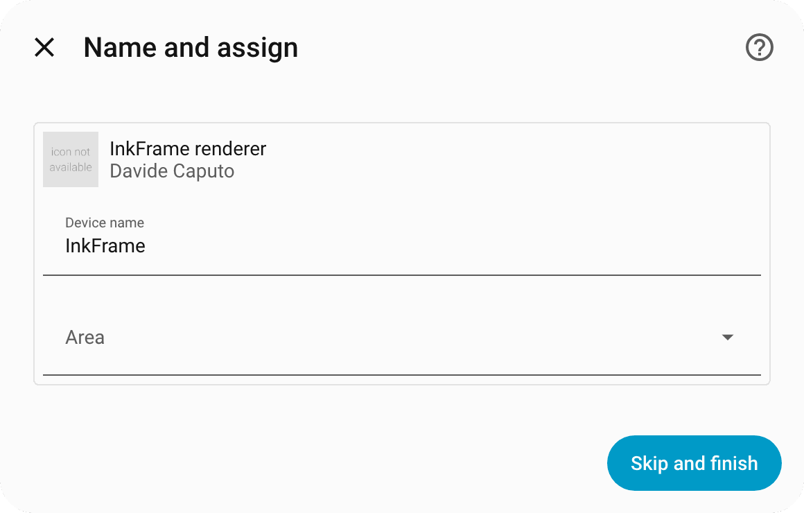

# 🧭 Setup

A numbered walkthrough from an empty desk to a photo on the glass. It takes about half an hour, most of it waiting for Docker and the first flash. The same steps in short form are in the [README](../README.md#-quick-start).

## Before you start

You need:

- **An Immich server** you can reach from the machine that will run the renderer, and permission to create an API key on it.
- **A host with Docker and Docker Compose** for the renderer. It can be the machine that runs Immich. It has to stay on, because the renderer answers the panel whenever the panel wakes.
- **The Seeed Studio XIAO 7.5" ePaper Panel** and a USB-C cable that carries data. See [Hardware](hardware.md).
- **A computer with Python** to flash the panel with ESPHome the first time.
- **Home Assistant** with HACS installed, for the integration. The panel and the renderer work without it; you lose the controls and the status.
- **One network** the panel's Wi-Fi, the renderer and Home Assistant can all use. Traffic is plain HTTP, so keep it on a network you trust.

## 1. Create the Immich API key and the shared token

In Immich, create an API key with exactly these permissions: `asset.read`, `asset.view`, `asset.statistics`, `album.read` and `person.read`. Add `face.read` if you want portraits cropped around faces. Without it the crop falls back to the centre.

The container runs as uid 1000 and reads both secrets from files, so save them with mode 0644:

```bash
mkdir -p ~/Secrets
printf '%s' 'YOUR_IMMICH_API_KEY' > ~/Secrets/immich_frame_api_key
chmod 644 ~/Secrets/immich_frame_api_key
openssl rand -hex 32 > ~/Secrets/inkframe_token
chmod 644 ~/Secrets/inkframe_token
```

The second command makes the **shared token**. The panel and Home Assistant both present it to the renderer. Treat it like a password: it grants access to photo previews and renderer controls.

## 2. Run the renderer

```bash
cd server
cp .env.example .env
```

Open `.env` and set `IMMICH_URL` to your server's address, for example `http://192.0.2.10:2283`. Every other variable has a default; [the API doc](api.md#environment-variables) lists them. Then:

```bash
docker compose up -d
curl -s -H "Authorization: Bearer $(cat ~/Secrets/inkframe_token)" http://localhost:8099/status
```

`/status` answers with a JSON document that includes `generation` and, once the first render has finished, the chosen photo. A `401` means the token does not match. An error about the API key means the file is unreadable by uid 1000; use mode 0644.

## 3. Flash the panel

```bash
cp firmware/secrets.yaml.example firmware/secrets.yaml
```

Fill in `firmware/secrets.yaml`:

| Key | Value |
|---|---|
| `wifi_ssid`, `wifi_password` | The network the panel joins |
| `fallback_password` | A password for the panel's own hotspot if Wi-Fi fails |
| `immich_frame_api_key` | A new ESPHome API key: `openssl rand -base64 32` |
| `immich_frame_ota_password` | Any password; it guards over-the-air flashing |
| `inkframe_token` | The contents of `~/Secrets/inkframe_token` |
| `frame_server_url` | Where the panel reaches the renderer, for example `http://192.0.2.20:8099` |

Connect the panel over USB-C and run:

```bash
pip install esphome
esphome run firmware/immich-frame.yaml
```

Choose the serial port when asked. After the flash the panel connects, calls `/wake`, fetches a frame, draws it and goes to sleep. The first draw takes about 35 seconds. Later flashes happen over the air, inside a wake window; see [Firmware](firmware.md#flashing-over-the-air-step-by-step).

## 4. Install the integration

In HACS, open the three-dot menu, choose **Custom repositories**, add `https://github.com/CaputoDavide93/InkFrame-Immich` with category **Integration**, then download **InkFrame for Immich** and restart Home Assistant. Custom integrations load only at start.

Without HACS, copy `custom_components/inkframe` from this repository into `<config>/custom_components/` and restart.

## 5. Add it in Home Assistant

Go to **Settings → Devices & Services → Add Integration** and search for **InkFrame for Immich**. Home Assistant asks for two values.

<picture>
  <source media="(prefers-color-scheme: dark)" srcset="assets/screenshots/setup-form-dark.png">
  
</picture>

- **Renderer URL:** the address Home Assistant uses to reach the renderer, for example `http://192.0.2.20:8099`.
- **Renderer token:** the contents of `~/Secrets/inkframe_token`, the same value you gave the panel.

Setup calls the renderer's `/status` with the token, so it fails at once on a wrong address or a wrong token, not at the first poll. Submit, and Home Assistant offers a name and an area:

<picture>
  <source media="(prefers-color-scheme: dark)" srcset="assets/screenshots/setup-created-dark.png">
  
</picture>

Skip it or name the device as you like; entity ids follow the device name.

## 6. Look at the device

Open **Settings → Devices & Services → InkFrame for Immich → the device**.

<picture>
  <source media="(prefers-color-scheme: dark)" srcset="assets/screenshots/device-dark.png">
  
</picture>

What to read on this page:

- **On the panel** is the photo the panel last acknowledged. **Up next** is the most recent render, which the panel collects at its next wake.
- **On panel** is off while a newer photo is waiting. That is normal between a render and the next wake.
- **Source** chooses where photos come from. Under **People**, switch **Include** on for the people you want.
- **Last check-in** is the last time the panel called the renderer. If it stops moving, see [Troubleshooting](troubleshooting.md#the-panel-is-asleep-and-i-need-it-now).

The setup screenshots use drawn demo scenes, so the images are not photographs. Yours show your library.

## 7. Check that a photo reaches the glass

The first wake after flashing draws, because the renderer has nothing recorded as collected yet. It takes about 35 seconds. When it ends, **On panel** turns on and **Last panel fetch** shows a recent time.

After that the panel wakes every **Sleep interval** hours (168 by default) and draws only when a draw is due (**Photo every** days, from **Photo hour**). Pressing the reset button on the back of the XIAO wakes it early, but a wake that finds nothing due only checks and sleeps again. To put a photo up at the next wake whatever the schedule says, ask for one:

```bash
curl -s -H "Authorization: Bearer $(cat ~/Secrets/inkframe_token)" "http://localhost:8099/next?now=1"
```

Then press the reset button. If the glass and Home Assistant disagree, start with [The photo did not change](troubleshooting.md#the-photo-did-not-change).

## Where next

- Pick a source and tune the picture: [Home Assistant](home-assistant.md).
- Change how often the panel wakes and draws: [Wake and sleep](wake-and-sleep.md).
- Something does not behave: [Troubleshooting](troubleshooting.md) and the [FAQ](faq.md).
